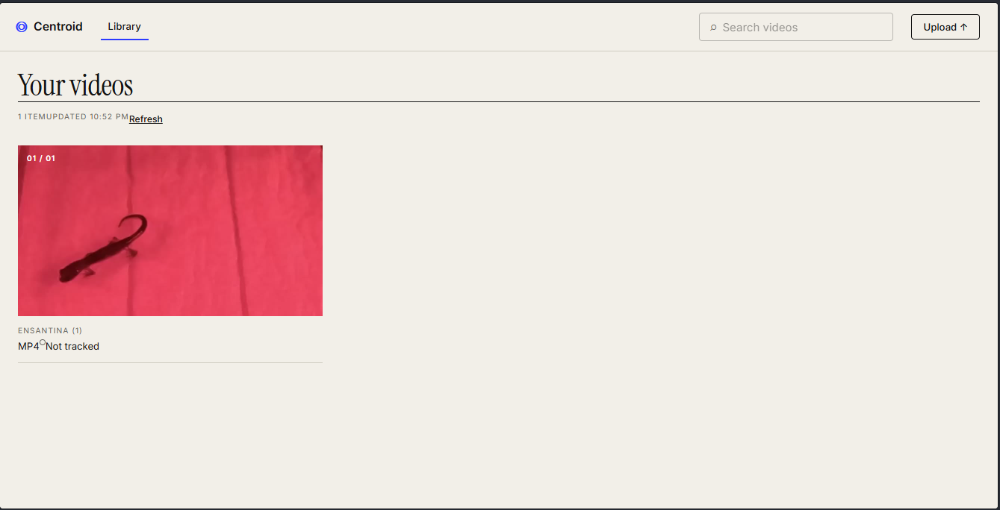
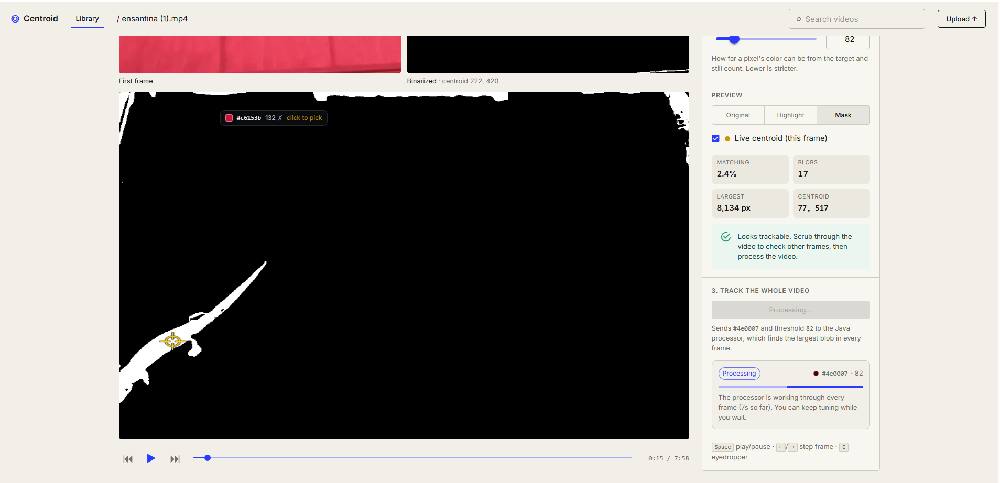

# Centroid Finder Frontend

A React app for finding and tracking a colored object in a video. Pick a video,
choose the target color, tune the threshold while watching a live binarized
preview, then send the job to the backend and follow its progress until the CSV
of centroids is ready.

This is the frontend for the SDEV334 Centroid Finder assignment. It talks to
the Express backend in the `centroid-finder` repo (`server/`), which runs the
Java processor.





## Features

- **Video Chooser (`/videos`)**: lists the videos from `GET /api/videos` with a
  first-frame thumbnail for each. Clicking one opens its preview page.
- **Preview page (`/preview/:filename`)**: shows the first frame from
  `GET /thumbnail/{filename}` next to a binarized copy that updates live as you
  change the threshold slider or the color. A dot marks the centroid of the
  largest connected group.
- **Process button**: "Process Video with These Settings" sends
  `POST /process/{filename}?targetColor=<hex>&threshold=<int>`.
- **Job tracking**: polls `GET /process/{jobId}/status` until the job is done
  or failed, shows progress, and links to the result CSV.
- **Material UI** for the layout and controls, with a dark theme.

### Unique feature: tracked-path playback

When a job finishes, the app downloads the result CSV and plays it back on top
of the video:

- the whole path the object took is drawn on the video, with a bright trail for
  the last moments and a dot at the current position;
- an x/y-over-time chart shows where the object was found, with red bands where
  it was not found. Clicking the chart jumps the video to that moment.

Smaller extras: an eyedropper (click the object in the video to sample its
color), a Highlight/Mask view of the live video, frame stepping with the arrow
keys, and the last job for each video is remembered across reloads.

### The centroid logic

[`src/lib/detection.js`](src/lib/detection.js) reimplements the Java processor
in JavaScript so the preview matches what the backend computes:

| Java class | What it does | JavaScript |
| --- | --- | --- |
| `EuclideanColorDistance` | distance between two RGB colors | `colorDistance` |
| `DistanceImageBinarizer` | white when distance is **strictly less** than the threshold | `binarize` |
| `DfsBinaryGroupFinder` | 4-connected groups (no diagonals), centroid by **integer division**, sorted by size, then x, then y | `findGroups` |
| `LargestGroupSelector` | centroid of the largest group, `(-1, -1)` when there is none | `largestCentroid` |

## Setup

You need Node.js 20 or newer. The backend runs separately, so set it up first.

1. **Start the backend** (from the `centroid-finder` repo):
   ```
   cd server
   npm install
   npm start
   ```
   It listens on `http://localhost:3000`. Put at least one video (for example
   `ensantina.mp4`) in the backend's `videos/` folder.
2. **Start the frontend** (from this repo):
   ```
   npm install
   npm run dev
   ```
3. Open <http://localhost:5173>.

In development, Vite proxies the API calls (`/api`, `/thumbnail`, `/process`,
`/results` and video files under `/videos/`) to `http://localhost:3000`, so the
browser sees a single origin. That is also what lets the canvas read video
pixels without CORS problems. The proxy settings are in
[`vite.config.js`](vite.config.js). Note that `/videos` itself is the React
route, so only `/videos/<file>` is forwarded to the backend.

## Using the app

1. Pick a video on the Videos page.
2. Choose the target color, either with the **eyedropper** (press `E`, then
   click the object in the video) or by typing a hex color.
3. Drag the **threshold** until only the object is white in the binarized
   preview.
4. Scrub through the video (`Space` plays and pauses, `←`/`→` step frames) to
   check the settings hold up.
5. Click **Process Video with These Settings**. When the status shows Done,
   use **Download CSV**, or look at the tracked path and chart.

## Tests

| Command | What it runs |
| --- | --- |
| `npm test` | Vitest unit tests for the detection math and CSV parsing |
| `npm run test:e2e` | Cypress end-to-end tests (headless) |
| `npm run cy:open` | Cypress in interactive mode |

The Cypress tests mock the whole API with `cy.intercept`, so they do not need
the backend. They do need the dev server, so start `npm run dev` in one
terminal and run `npm run test:e2e` in another.

They cover the `/videos` and `/preview/:filename` routes, the list, error and
empty states, the live binarized preview, the exact `POST /process/...` request,
and status polling through to the CSV link.

**Windows note:** if Cypress fails with `bad option: --smoke-test`, your
terminal has `ELECTRON_RUN_AS_NODE` set (VS Code terminals do this). Clear it
first: `unset ELECTRON_RUN_AS_NODE` in bash, or
`Remove-Item Env:ELECTRON_RUN_AS_NODE` in PowerShell.

## Project structure

```
src/
  App.jsx                  routes (/videos, /preview/:filename) and app shell
  api.js                   fetch wrappers for the backend API
  theme.js                 Material UI theme
  hoc/withVideoList.jsx    higher-order component: fetches videos, handles loading/error/empty
  hooks/useJob.js          polls the job status
  components/              VideoLibrary, Workspace, PreviewPair, ColorField, TrackChart
  lib/                     detection (Java port), drawing, CSV parsing, saved jobs
cypress/                   end-to-end tests and the mock frame fixture
```

## Backend API used

| Method and path | Purpose |
| --- | --- |
| `GET /api/videos` | list of video filenames |
| `GET /thumbnail/{filename}` | first frame as a JPEG |
| `POST /process/{filename}?targetColor=<hex>&threshold=<int>` | start a job, returns `{ jobId }` |
| `GET /process/{jobId}/status` | `{ status: "processing" \| "done" \| "error", result?, error? }` |
| `GET /results/{file}.csv` | the finished CSV (`seconds,x,y` per frame, `-1,-1` when nothing was found) |
